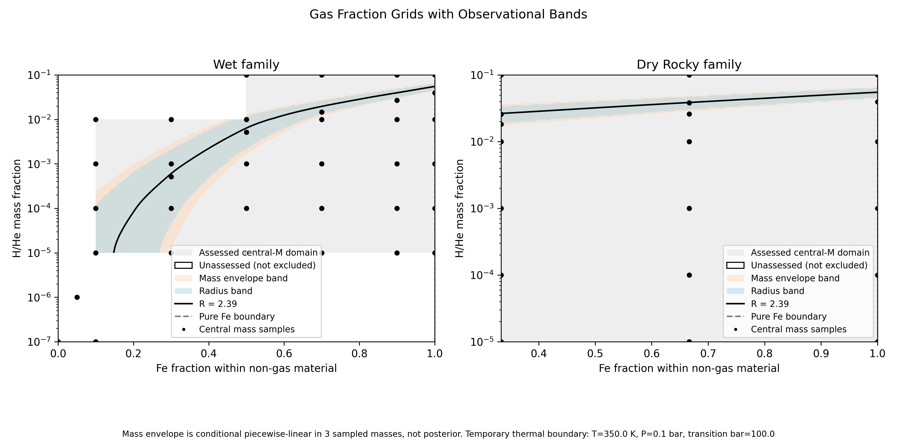

# TOI-732 c：有水与两种无水粗组成约束

2026-11-13交付，可重复运行的开发版。**当前350K/.1bar/100bar测试热结构下，有水、铁＋硅酸盐＋气体、纯铁＋气体均有真实匹配点；不能说必须含水。** 正式TP/气候结构与组成后验尚未完成。

[手动运行指南](docs/TOI732C_RUN_GUIDE.md) · [结果、方程与问题解释](research/composition-constraints-20261112/delivery/README.md) · [协作交接](research/composition-constraints-20261112/delivery/HANDOFF.md)

三个质量7.56/8.04/8.54 M⊕分别正向计算m_i=f_iM，再比较观测R；没有把观测半径强设成计算结果。175次扫描/验证模型通过独立保存状态审核（170542行、最大密度误差1.36e-7），最终150点插值＋25点验证分开。6个新局部中心线误差≤.00311R⊕；边缘仍有.01142，不声称整片面积精度、物理认证或后验。

[三元图](research/composition-constraints-20261112/delivery/figures/ternary.png) · [质量切片图](research/composition-constraints-20261112/delivery/figures/mass-slices.png)，均有同名PDF。蓝色是中心质量的半径比较带，橙色是三质量条件包络；白色未评估不等于物理排除。

运行入口只有run/{scan_compositions,execute_scan,plot_compositions}.py，复用C++主程序，不需AI API。前两者只用Python标准库，绘图用NumPy/Matplotlib/SciPy。输入模板和精确AQUA子表在input/toi732c-test，原始大表不改。DeepSeek编程，Codex定义验收和执行，独立Codex核验。

根src已合入有外部TP时的有限域半径初始化修复；短TP仍拒绝，不外推/截断表。本轮网格使用无外部TP的统一真实H/He等温-绝热近似。详见[TP修复证据](research/composition-constraints-20261112/stageB/README.md)。

开发与新猜想只在yt2523/Magrathea的research/composition-constraints-20261112。cid02399021手动仓库及master/run本轮未动。原始结果按新目录归档，保留旧失败。204次任务启动中199模型、5旧失败；DeepSeek调用43次已记账，用户取消任务调用上限。**本轮计算已停止**，不因为剩余额度自动补扫。

English: coarse conditional delivery, not a posterior. Wet and both dry controls have real native matches. Three mass knots propagate conditional sensitivity; local centreline checks pass, full-area edges remain approximate. Follow run guide and handoff before changes. Preserve all old bytes; never silently change TP, EOS or interpolation assumptions.

[Zotero归档与回执](research/composition-constraints-20261112/delivery/zotero-delivery.json)：输入、数值摘要和图已分流到对应新子目录，三个stored附件MD5验证通过。
