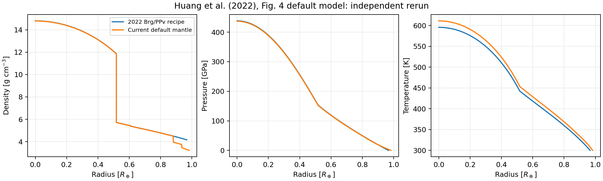
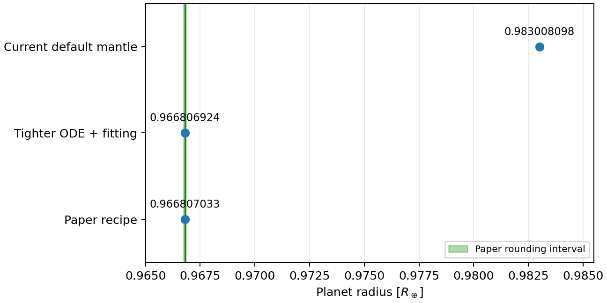

# 首个论文模型复现：Huang et al. (2022) 图 4 默认模型

**结果：在论文标注的四位小数精度内复现半径。** Ubuntu / WSL2 实算为 **0.966807032925 R⊕**，图例给出 **0.9668 R⊕**。这是一个双层、1 地球质量的代码验证模型，供后续亚海王星研究建立基准。

## 目标与事先判据

Huang, Rice & Steffen (2022), *MAGRATHEA: an open-source spherical symmetric planet interior structure code*, MNRAS 513, 5256–5269，DOI [10.1093/mnras/stac1133](https://doi.org/10.1093/mnras/stac1133)。依据 [§5.1 / 图 4](https://academic.oup.com/mnras/article/513/4/5256/6574421) 与 [arXiv PDF，第 9 页图例](https://arxiv.org/pdf/2201.03094)。正文半径写作 0.967 R⊕，图例为 0.9668 R⊕，采用后者比较。

运行前写入 [plan.json](results/plan.json)：参考半径 0.9668 R⊕，允许差值为末位四舍五入半宽 0.00005 R⊕。这个范围来自论文显示精度，不是观测误差或求解器误差预算；没有为匹配半径调整质量、温度或 EOS 参数。

|输入|本次设置|来源或说明|
|---|---|---|
|总质量|1 M⊕|论文 §5.1|
|核 / 幔质量|0.33 / 0.67 M⊕|论文 §5.1；不同于之前的 0.325 / 0.675 练习|
|表面温度|300 K|图 4 默认模型|
|表面压强|0.1 bar = 1e5 microbar = 1e-5 GPa|论文 §2 默认边界|
|界面温差|全为 0 K|论文 §2 对 §5 演示的说明|
|铁核|Fe_default，实际为 Fe hcp (Smith)|论文默认铁核|
|地幔|Si_simple：Brg/PPv；实际为 Brg (Oganov)、Si PPv (Sakai)|论文地幔；新版 Si_default 包含额外上地幔相|
|水 / 气|0 / 0|双层模型|
|全局等温|false（原 mode 0 固定传参）|使用完整热结构求解器|

与 Git 历史的 `1487d26`（2022-04-23）比较，论文时期默认地幔的 Brg/PPv 分支与当前 `Si_simple` 的判断式一致；铁 hcp、Brg、Sakai PPv 的 EOS 数组未见差异。运行使用当前源码基线 `4c560f36d2734f6b63ae5118d4074e0c255b59f0`，不是重新编译全部历史版本；源码 SHA256、编译器与 GSL 版本见 results.json。

## 计算与检查

|运行|R/R⊕|相对论文显示值差异|状态|
|---|---:|---:|---:|
|论文配方基准|0.966807032925|+0.000727444%|0|
|相同输入重复|0.966807032925|+0.000727444%|0|
|ODE 与匹配容差各加严 10 倍|0.966806924202|+0.000716198%|0|
|新版默认地幔对照|0.983008097876|+1.676469%|0|

基准中心压强 438.208432 GPa、中心温度 595.651072 K、核半径 0.517433561 R⊕。这些是本次模型输出，没有独立论文精确数值用于逐项验证。

容差加严：ode_eps_rel1 从 1e-10 到 1e-11，fit_eps_rel 从 1e-4 到 1e-5；半径相对基准改变约 -1.12456e-7。重复运行半径和输出剖面均逐字节一致。只增加只读日志的临时 main 构建与原 CLI 的基准剖面逐字节一致；[补丁](results/diagnostic-logging.patch) 只作用于临时副本。未修改科学求解器或 EOS。

内置 Vinet EOS 反演与均匀密度球测试通过。verify.py 检查四个剖面的有限性、正 P/ρ/T、质量与半径排序、压强向外不增、中心条件、外边界、哈希、模型状态、重复性、容差变化、论文半径显示精度及原 CLI 一致性。

独立复查后，入口改为 `make -B -j4`，防止 Makefile 漏跟踪头文件或编译选项而复用旧对象。强制重编后重新运行全部模型与检查，五份剖面与第一次运行逐字节一致，见 [重编核查](rebuild-check/rebuild-comparison.json) 和 [完整运行记录](rebuild-check/results.json)。故意将测试副本半径改为 0.98 R⊕ 时，核查入口会按论文精度判据拒绝它。

图中的曲线均为本次重新计算；未把论文曲线数字化或叠加冒充原图。温度和密度变化也受相图与 EOS 热参数控制。新版上地幔相可改变整体半径；该对照只改变 `mantle_phasedgm`，有助于理解为何当前默认配置无法直接照搬 2022 年结果。

## 文件和复跑

- [原始配置](results/configs)、[剖面](results/profiles)、[日志](results/logs)、[高精度结果与环境](results/results.json)、[半径差异 CSV](results/comparison.csv)。
- [运行入口](reproduce.py)、[独立核查入口](verify.py)、[绘图入口](plot.py)。新输出目录的完整命令见 [experiments/README.md](../README.md)。
- 本机 Ubuntu 26.04 / g++ 15.2.0 / GSL 2.8，标准库 Python 运行；图由已有 Windows Python 3.12 / NumPy / Matplotlib 生成。

**范围：**完成图 4 默认模型的半径基准；没有复现 ExoPlex、“Adjusted” 模型、整篇论文、100 次计时实验或 TOI-732 c 的反演。没有精确原始参考剖面，不能声称整条 P/T/ρ 曲线逐点复现。数值稳定性检查也不是严格的全局误差界。

## English

The default two-layer benchmark in Huang, Rice & Steffen (2022), Fig. 4, is reproduced at the printed radius precision: 0.966807032925 R⊕ versus 0.9668 R⊕. Inputs are 1 M⊕, 33% iron core, 67% Brg/PPv mantle, 300 K surface temperature, 0.1 bar surface pressure, and zero interface temperature jumps. The current `Si_simple` option preserves the paper's mantle recipe; the current default additionally contains upper-mantle phases.

The criterion was saved before running: an absolute radius difference no larger than 0.00005 R⊕, half the final printed digit. Identical reruns and tighter ODE/fitting tolerances were checked, along with physical profile checks, solver status, hashes, built-in tests, and equality with the uninstrumented CLI. Full-precision logs are used for comparisons because profile output is rounded and decimated. This validates one reported radius, not the entire paper or pointwise reference profiles, and does not constitute a reconstruction of the complete historical code environment. Earlier sub-Neptune calculations remain explicitly labeled literature-inspired recipes with retained caveats.
