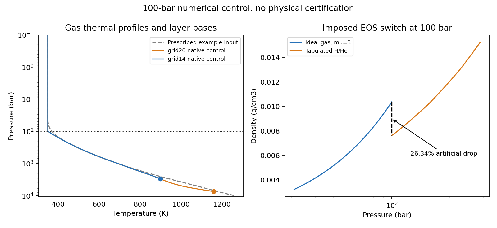

# 100 bar 原生热结构对照：完成与交接

**结论：CONDITIONAL_NUMERICAL_PASS_WITH_HYBRID_LIMITATION。** grid14、grid20 各完成普通及加严计算，共4次；保存剖面与容差敏感性验收通过。**physical_acceptance=false**：100bar 原生接口仍有26.341%人为密度下降，水EOS拼接亦有现存跳变，不把数值收敛当物理认证。

开发远端只用 **https://github.com/yt2523/Magrathea**，分支 `research/100bar-control-20261112`。手动发行仓库 cid02399021/Magrathea 本轮未推送、未修改；旧发布记录不覆盖。

## 先给接手 AI 看

1. 读根README、AGENTS和本页，再读 [接口速查](INTERFACE_NOTES.md)、[本轮续接计划](RESUME_PLAN.md) 与 [原始计划](PLAN.md)。Codex负责规格/固定检查/执行；DeepSeek负责代码与修复；独立Codex负责最终验收。
2. 实际当前状态在 `contract.json`、`final-independent-review.json`；旧 `PREVIOUS_REPORT.md` 只记录被拒绝的上一版，转义指控的更正见 [AUDIT_CORRECTION](AUDIT_CORRECTION.md)。不要由旧状态重新开始计算。
3. `tests/native_hhe_control_audit.cpp` 为DeepSeek修复的诊断包装器，不改原生物理代码。旧检查文件继续保留，且不是全部通用：prescribed-TP检查器需要TP sidecar，不能直接套在本次无外部TP配置上。
4. 原始4次输出在 `results/`，诊断探针、固定验收、模型/配置哈希均保存；无历史网格重跑。预算重置前88次记录保留，本次新周期用2次DeepSeek调用；没有自动花剩余额度。

## 模型与输入

纯铁核＋独立水层＋气层，Si0；M=8.04ME，P0=.1bar，T0=350K，温度跳跃均0。350K及该外边界继续标为示范条件。100bar为规定的近似分界，不是测得或自洽计算的辐射—对流边界。

`HHe_tabulated` 的原生行为是低于100bar用等温ideal mu3，100bar及以上用Chabrier H/He表密度和绝热温度梯度。它替代整条外部TP，不是在10000bar处补表。与旧 prescribed-HHe 相比，热结构和低压密度EOS都变了，因此不能把半径差解释为纯TP形状效应。

|组成质量分数|Fe|H2O|gas|
|---|---:|---:|---:|
|grid14（旧成功点）|.2997|.6993|.001|
|grid20（旧失败点）|.2991|.6979|.003|

配置保留旧输入的精确质量字符串。基线在 `configs/`，四次实际配置各在对应 `results/<case>/run.cfg`。

## 实际结果

|case|计算半径 RE|气层底压 bar|气层底温 K|保存并检查的行数|
|---|---:|---:|---:|---:|
|grid14|2.3466689|3040.9032|899.05948|696|
|grid14-tight|2.3466690|3040.9030|899.05944|919|
|grid20|2.5171382|7499.9883|1159.5632|698|
|grid20-tight|2.5171382|7499.9886|1159.5631|914|

半径来自原生8有效数字输出；grid20 两次相等仅指保存精度内相等。普通/加严半径相对差：grid14 4.26136e-8；grid20在保存精度内0，均小于固定1e-5阈值。共同1000bar处温度相对差2.50984e-7和3.34110e-7，均小于固定1e-3阈值。

四次均严格EOS审计开启、被拒绝查询0、最终保存状态无表域外查询。144项既有原生EOS单元检查通过；新工具气体标识/单位/CSV解析/非法输入拒绝/防覆盖门通过。全部3227行保存状态均用其保存P/T重新查询EOS，最大密度相对差8.05813e-8；独立H/He双线性和理想气体公式复核一致。原生打印是子采样，不能说核查了全部ODE内部状态。完整开发工作区也已按下方README命令实际编译通过，未为构建验证追加行星计算。

气层保存区间的温度割线与端点平均绝热导数残差最大约9.3e-4；这是有界区间/保存精度诊断，不是全局积分误差上界。逐区间、表格单元跨越记录见 `thermal-interval-details.csv` 和 `thermal-interval-summary.json`。

## 交界检查与科学限制

- 保存的铁—水、水—气交界 P/T 在输出精度内连续，按保存温度重算密度未复现旧“用旧温度算密度”的错误。不同材料密度不必连续。
- 100bar同压同温的气体EOS切换密度从.01038407311734268降到.007648804377033426g/cm³，下降26.341%。这是不同近似EOS/组分的接缝，保持 `FAIL_HYBRID_DENSITY_CONTINUITY`，不是已确认相变。
- 原有Water_Brown/Mazevet在1280K的拼接也出现向内约15.65%（grid14）和19.36%（grid20）的密度下降；grid14还经过现有IceX/水EOS接缝。源代码有相关切换，未修改；不能据密度重算一致就认证这些拼接物理正确。
- 原生无TP CLI不暴露内部ode_status及原始拟合残差，本轮不认证这些量。验收范围是保存剖面、严格域检查和容差复算。
- grid20能算通，只说明这套改变后的近似可求解；其7500bar底压不能倒推旧TP真解也在表内。旧TP初始化域外试探问题未修复。
- 若仅参照旧固定质量半径区间[2.28,2.49]RE，grid14在其中、grid20略高；不是质量联合误差后验，也不据此宣称组成被排除。



## 自己运行：必须新输出目录

在仓库根目录用已有C++/GSL环境（推荐WSL）：

```bash
make -j2
g++ -std=c++11 -O3 -Wall -I. -Isrc tests/native_hhe_control_audit.cpp \
  src/EOS.o src/EOSlist.o src/EOSmodify.o src/compfind.o src/hydro.o \
  src/parser.o src/phase.o src/tp_diagnostics.o src/tp_profile.o \
  src/tp_settings.o src/tp_stepper.o -L/usr/local/lib -lgsl -lgslcblas -lm \
  -o tests/native_hhe_control_audit
```

先复制 `configs/grid14.cfg` / `grid20.cfg`，把 `output_file` 改为自己新建的目录；档案内绝对路径只是本次运行身份。不要复用旧输出路径：原生`hydro::print`会追加，包装器只主动拒绝覆盖runtime/probe/check输出。

```bash
mkdir -p result/my-new-control
tests/native_hhe_control_audit --probe result/my-new-control/probe.csv
tests/native_hhe_control_audit --run my-new-grid14.cfg result/my-new-control/runtime.json
tests/native_hhe_control_audit --check result/my-new-control/model.dat result/my-new-control/checked.csv
```

`model.dat`须与新cfg的output_file对应。退出0不能替代验收：检查新剖面、runtime严格审计、域与密度、物相/温度边界和容差敏感性。本任务已经达到4次运行上限，以上仅供用户另开明确任务自行运行，不授权AI自动续跑。

## 构建和归档身份

开发基线run=790ab23d2f82a79e1cb14460e08e51f7be1458b2；冻结物理源码与本分支src/tabulated按统一换行比较38文件一致，`compiled-physics-hashes.json`记录实际编译源字节。DeepSeek包装器源SHA256=f0a34bbb88bd03d58eb99d9b159773de4ec3ddb1978baf03c3a86a12482c312b；二进制SHA256=471c3475deb7387b9c7e86f4ba2ac0fffe1530bdd7f8035f9e68e0098a2c04ac。

大二进制、原始模型API响应和调用上下文留D:/Codex/downloads/toi732c-100bar-control-20261112-resume01，不上传凭证/私有响应。已审查源码、配置和约750KB实际小型数据直接归档，协作者无需访问本机D路径即可读结果。

## 下一步最小改动（未自动开始）

先讨论将气层密度统一为同一种H/He EOS、只在100bar切换温度方程，消除混用mu3造成的人为接缝；同时保留水EOS拼接问题的单独核验。再考虑30/300bar热结构敏感性和原TP域受限初始化修复。当前不跑新网格或加速搜索。

## Zotero 交付位置

- Output data → `100bar thermal control — 2026-11-12`（collection2MSFRUC2）：4次真实输出包及Data_explanation，数据item4SGNKVAT。
- Output graphs → 同名本次目录（collection2STVTNVX）：PNG与Graph_explanation，图itemP5CSWM9E。
- Data顶层来源索引EJSSR9QH交叉列入Magrathea与AI-Notes。stored附件MD5已回读核对。
- Zotero引用的代码/数据固定版本为a44013c861758df01b4118b8e8d3e63c5fb95709；后续交付索引提交不改变这4次计算。
