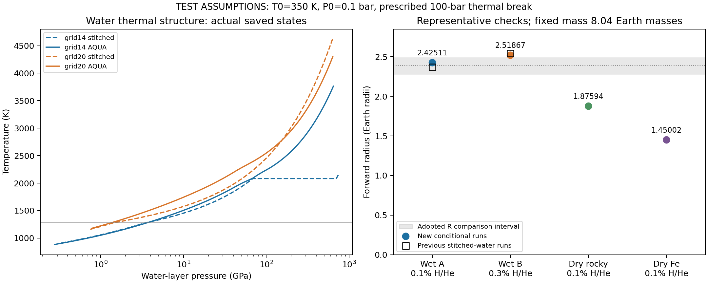

# 有水/无水组成任务：第一阶段交付

**状态：来源/EOS核查与8份代表结果的有限数值检查通过；长程任务仍进行中。** 独立审核见independent-review.json，逐项证据见verification-summary.json。用户已选择AQUA作有水主方案，旧拼接作有限对照。无水两种模型均纳入第一批图，不推迟到后续。

## 原理和实际改动

不改生产C++、物理公式、物相边界或原始表格。复用现有water_tabulated选择器，AQUA同时提供水密度和温度梯度；原默认水模型在1280K硬切Brown/Mazevet，IceX无热参数因而等温，700GPa再硬切Mazevet。新模型改变的是整套水层热力学处理，不只是把密度曲线画平滑。不同方案的密度/热结构会改变同质量下体积及最终半径。

DeepSeek编写开发用tests/native_water_audit.cpp；Codex定义固定检查、执行/算术/作图，未参与实现的Codex审核实际文件。7次DeepSeek调用，包含失败修复，原始响应留私有D盘不入Git。

## 表格和来源核查

本地AQUA原表793压力段×286行，但351段高温坐标不一致；现有读取器假设共用温度轴。差异在约5万K以上，因此不能直接认证整表。隔离比较目录仅保留原表T<=50000K的原字节行（793×270，实际最高48978K），所有压力段温度轴一致；不外推、不改数值，仓库原表保留。bounded-aqua-fixture.json记录原表及子表SHA。

官方发布包按LFS SHA256核验。官方单位Pa、kg/m3、无量纲nabla；本地GPa、g/cm3、K/GPa，转换nabla=(P_GPa/T)*dT/dP。66个相关范围独立比较，密度差最大0.038004%，梯度差最大0.479430%。这只是来源/单位佐证，不是全域或物理认证。作者原插值用logP/logT，本地用linearP/linearT；如实记录，未静默改算法。来源：Haldemann etal.2020 DOI10.1051/0004-6361/202038367，https://github.com/mnijh/AQUA 。

同状态探针确认：1280K处P1.4422569/3.5128559GPa的Brown→Mazevet密度下降19.3572%/15.6462%；700GPa、2082.6391K处IceX→Mazevet下降9.0429%。不能统称为已确认真实相变。

## 输入和结果：真实solver，测试热边界

均M8.04ME、P0=.1bar、T0=350K、100bar规定热分界，不是正式交付TP或已测真实RCB。每个组成为先正向算R，再比较观测；没有用观测R强制构造模型。

|模型|质量分数Fe/Si/H2O/HHe|R普通/加严 RE|
|---|---|---|
|有水AQUA A|.2997/0/.6993/.001|2.4251107/2.4251107|
|有水AQUA B|.2991/0/.6979/.003|2.5186717/2.5186715|
|无水岩石主对照|.333/.666/0/.001|1.8759446/1.8759447|
|无水纯铁端元|.999/0/0/.001|1.4500168/1.4500168|

先前相同有水输入的默认拼接模型R2.3688889/2.5427244RE，分别变化+.0562218/-.0240527RE，不能当数值舍入。无水g=.001的两个点偏小，不能证明行星必须含水；尚未扫描更高气体比例。

10次启动=8成功+2失败，失败均保留。首次保守选T<=10000K子表导致初始半径试探在P6815.66GPa、T10000K受限，exit0但无模型、71次拒绝；只开启verbose定位一次后，扩大到原表已有且坐标一致的48978K范围，后续8次成功均严格审计true、拒绝0。这个10000K诊断上限不是旧外部TP的10000bar上限，两者不得混淆。

8752保存状态密度重算最大相对误差7.3748e-8；4组半径普通/加严相对差均<1e-5。无理想气体查询，两种无水模型输入水质量0、实际水EOS查询0。10个固定输入保护/单位/覆盖检查通过。原生内部ODE状态/原始拟合残差仍未公开，保存剖面检查不能替代它们。

图左是水层实际保存TP，右是代表半径。灰区仅既有半径比较区间[2.28,2.49]RE，尚未加入质量误差，不是组成后验。

## 复现与下一步

代码和原表来自base10dc38e；本阶段所有生产.cpp/.h与该版本相同。复用上一阶段已验wholeELF而非旧.o，SHAafb5f9c42652489f770b54a92ddcf41c1452852ae2fe89e34aa3541df3b2ad60；每次运行cwd指向隔离source，由此读取明确哈希的AQUA子表。换cwd/表就是换模型身份。重新构建用make -B。

诊断是开发工具，不是完整手动发行版；实际命令/子表准备见scripts与逐次run.cfg（档案含本次D盘绝对路径，复现时需新建输出目录并替换路径）。大表和ELF在D盘任务目录；从仓库原表按声明筛选能复现子表哈希。所有旧结果不覆盖。

下一步B：DeepSeek修复外部TP初始化的可计算半径括区搜索，固定有限试探，不外推TP、不把失败残差伪装成正/负。之后质量向量及有水/无水粗网格、气体范围覆盖核查、局部加密和三元/气体比例/质量切片图。第一轮96粗网格点额度含24新增岩石无水对照，纯铁端元去重；总上限180次行星启动/12次DeepSeek，当前10/7。若实现预算不足，先报告可复核进展，不静默重置。
