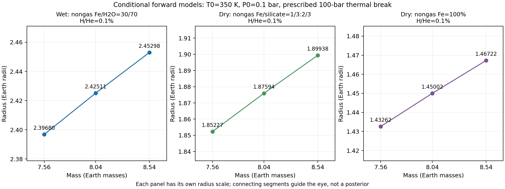

# 三质量切片：有水与两种无水代表（已验收，非完整网格）

**8次新行星计算＋1份相同程序/参数的中心有水结果复用，三种组成各3个质量。** 另有先前4次无水普通/加严，StageC合计12次启动，均保留。

|M/ME|有水AQUA|无水铁核＋硅酸盐|无水纯铁|
|---:|---:|---:|---:|
|7.56|2.3968001|1.8522665|1.4326158|
|8.04|2.4251107|1.8759446|1.4500168|
|8.54|2.4529772|1.8993762|1.4672245|

表内R单位RE。质量分数分别Fe/Si/H2O/HHe=(.2997,0,.6993,.001)、(.333,.666,0,.001)、(.999,0,0,.001)。每个质量重新计算各层质量m_i=f_i*M，然后原生solver重新积分求R；没有按旧半径缩放，没有把观测R设成输出。

输入M8.04+0.50−0.48ME和R2.39+0.10−0.11RE来自[Bonfanti等2024](https://doi.org/10.1051/0004-6361/202348180)。当前只取中心及上下边缘三点，不假定这是完整质量分布，也没有M/R协方差。T0=350K、P0=.1bar、100bar规定热分界均为条件测试假设。

独立审核核对8组各层质量、6415个保存状态、无水零查询和程序身份。保存密度最大相对差7.5323e-8，严格表域拒绝0。用两端质量的线性插值预测独立中心点，三类误差.0007953/.0006040/.0004498RE，小于本地.01RE目标；这不是整个组成域的插值误差界。

每幅图纵轴不同，连线仅辅助阅读。它展示质量误差怎样影响前向半径，**不是完整三元组成区或组成后验**。两种无水模型在g=.001下半径偏小，不能证明行星必须有水；更大气体比例待扫描。

所有模型使用已实测的StageB第11次候选ELF，SHA1fad237de60ab2fd029c9ea64e7d51b86b246e7b8a8caad14ce14f5751b939cd；这里不启用外部TP，不调用有已知漏解边界的辅助函数。源和程序集身份完整记录，不能把这些结果冒称为尚未应用的第12次修复。当前仅配置/控制器实验，面向用户的通用质量向量和扫描入口尚未实现。

原生无TP未公开内部ODE状态/原始拟合残差，保存剖面与加严证据不能替代这些量。配置config_sha256为LF归一文本SHA；新增原字节SHA见上级config-identity-conventions.json。
