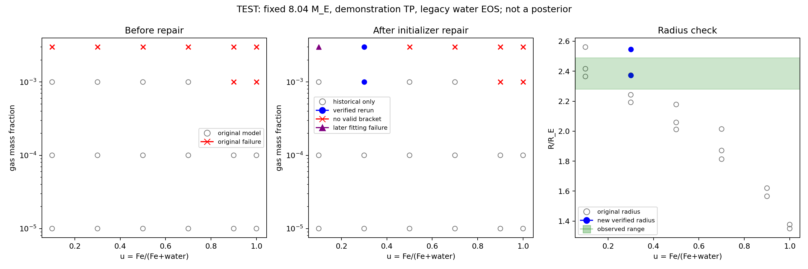

# 原8个叉与10000 bar边界核查（TEST，2026-11-16）

基线e3d4c0f；在yt2523开发分支，不更改cid手动库或master/run。唯一交接继续使用Zotero VDGBVMRW，不另造交接。本目录是固定科学证据。结果：**仅原grid-20恢复；6点仍无有效括区，grid-19进入后续拟合后失败。不能宣称整排叉修复。**

## 为什么这次比较有效

原网格固定M=8.04M_E、Fe/旧拼接水/HHe、Si=0、示范TP。旧16点只读复用；只补8个失败、grid14成功控制、grid20加严，共10次。冻结源D:/Codex/downloads/toi732c-pure-fe-pilot-20261106-run02/frozen-source，TP SHA及表哈希见evidence/manifest.json。复制其src/Makefile/表，仅覆盖根src/hydro.cpp和radius_bracket.h；前者与旧文件唯一差异为Rloop初始化及include，代码diff存档。没有换AQUA或更改EOS/TP插值/表范围。早先AQUA final20=2.5226744不是同EOS对照，不能冒用。

初始Rguess由平均密度估算；之后正向积分构造结构闭合残差，与Robs无关。新初始化有限搜索有效异号括区，无效试探保留为屏障，不赋假残差。根源修复为已验收DeepSeek代码；本轮没有新增生产C++修改。DeepSeek写辅助控制器/诊断补丁/图，Codex执行及独立审核；Codex仅图例位置/轴样式微调及只读核算。被拒绝/截断脚本未执行native，原始API不进Git。

## 结果

|旧case|当前状态|说明|
|---|---|---|
|17,18,21,22,23,24|UNRESOLVED_BRACKET|10次试探无有效异号括区；不是物理排除|
|19|FIT_INNER_FAILURE|已过初始化，在two-side fitting中内支未落到Mfit；不是同一种TP错误|
|20|PASS_CONDITIONAL_NUMERICAL|R=2.5470246531826537 R_E，气底7468.6874897bar，仍高于观测上界2.49|
|20-tight|PASS_CONDITIONAL_NUMERICAL|R=2.547024662437702，绝对差9.255e-9 R_E|
|14控制|PASS_CONDITIONAL_NUMERICAL|R=2.373594789407534，比旧结果差2.7634e-8 R_E；保持区间内|

用**未修改**tests/check_pilot_model.py核查三个保存模型，独立审阅者再次运行完全一致；涵盖质量、气层边界、R/P/T拟合残差、严格表域、逐行EOS/密度/TP温度与零组分调用。密度误差不放宽，max约7.12e-16。检查数值条件通过，不等于热结构/组成物理认证。

随后仅17和21各增加一次诊断，总启动12次。诊断补丁由DeepSeek给出，cap10→40并记录残差；未进入生产src。17有22个有效样本，21有24个，均正，最小残差分别3.17236e8cm、3.43981e8cm。向局部内侧试探遇TP上限，两者均未生成模型。有限采样不能证明全局无根，也不能认定最终气层一定超过10000bar；故未再盲目增加次数或扫描其它旧点。

## 图与数据



灰空心为历史成功，蓝为本次通过复核（包含控制14及恢复20），红叉为仍无括区，紫三角为后续拟合失败。右图绿色为半径比较盒[2.28,2.49]，非后验/68%概率区域；失败不赋半径、不连成排除线。数据comparison-initial.csv、verdict.json、independent-checks.json。u=Fe/(Fe+water)；实际Fe=(1-fgas)u。观察质量不确定性不在本次单质量对照中重算。

## 10000bar是否该延长：当前判决

**尚无证据可把这7个失败全部判成最终TP不足；不为消叉自动放大表上限。** grid20证明有一类旧叉确实仅因初始化；其余分别保留数值/覆盖未决和内支拟合失败。

末端热梯度辅助核对(deep-slope-diagnostic.json)：示范TP在10000bar,T1258.359K附近logT-logP有限段割线≈0.23979；实际T-lnP插值的端点左侧切线≈0.23831；同点H/He表第四列dT/dP的原轴双线性查询换算P/T*dT/dP≈0.39985。约1000bar两者≈0.287与0.280。该查询只是诊断，未复刻native float轴、未认证RCB。它至少不能支持“因为表到10000bar，所以从这里起必然已经绝热”。实际辐射梯度、opacity、通量、成分梯度等未提供，不能据这几个数声称全域稳定性或定位RCB。

MAGRATHEA论文采用低压等温/深部绝热近似（https://doi.org/10.1093/mnras/stac1133），Desai2024同样采用100bar分界（https://doi.org/10.3847/1538-3881/ad29ee）；它们是可声明的热结构情景，不是本星或该示范表10000bar接点的观测/推导证明。已有100bar主网格不能混作此处旧示范TP的同条件修复。

搭档2026-11-15 PICASO探索TP为1e-6..100bar，尚未批准MAGRATHEA P_ref/P0/T0及化学/EOS对应；不自动接入。下一步需协调深部热结构：优先取得带对流/通量诊断的更深TP，或明确批准一个EOS绝热接续的**敏感性情景**，不把结果称真实RCB/旧TP原解；之后先代表点再扫描。剩余19的内支失败应与该物理选择分开诊断。本轮没有新增未经依据的深部温度，也未声称边界问题全部解决。

## 重现与证据

脚本controller.py只负责prepare/run，Linux/WSL+已有g++/GSL，标准库；禁止复用已存在out或cases。源依赖旧冻结路径，属于开发证据脚本，非独立用户发行版。示例(新out必须不存在)：

```sh
python3 -B scripts/controller.py prepare --repo /mnt/d/Codex/downloads/subneptune-research-workflow --old /mnt/d/Codex/downloads/toi732c-pure-fe-pilot-20261106-run02/frozen-source --out /mnt/d/Codex/downloads/my-new-audit
# run会启动10次真实计算，仅在需要主动复现时运行，不作为只读验收
python3 -B scripts/controller.py run --repo /mnt/d/Codex/downloads/subneptune-research-workflow --old /mnt/d/Codex/downloads/toi732c-pure-fe-pilot-20261106-run02/frozen-source --out /mnt/d/Codex/downloads/my-new-audit
```

原始model/TP sidecar用gzip无损保存（mtime0），源码/表/配置/二进制SHA及日志保留。search40是额外诊断而非稳定发布，脚本路径记录当次D盘位置。没有重跑完整旧网格，没有修改科学验收阈值。新窗口先读唯一Zotero交接和docs/workflow/YEAR4_PROJECT_RULES.md。
