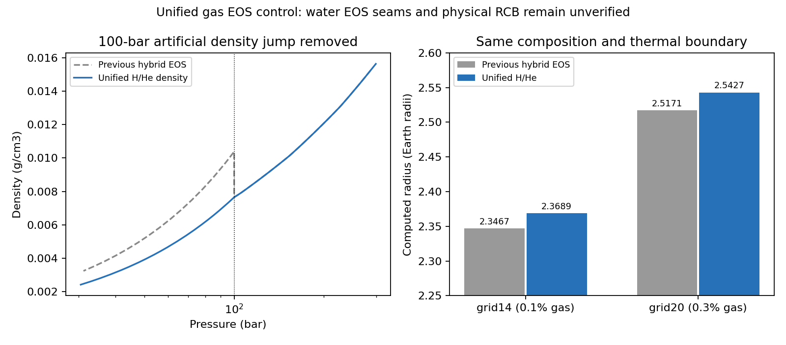

# 统一H/He密度、100bar热分界 — 完成与接手说明

**状态：PASS_BOUNDED_GAS_DENSITY_CONTINUITY_AND_NUMERICAL_CHECKS。** 原生混合接口的26.341%人为气体密度跳变已在新可选模式中消除；两个组成各完成普通/加严计算，共4次后停止。完整物理认证仍为false。

开发远端只用 https://github.com/yt2523/Magrathea ，分支 `research/unified-hhe-100bar-20261112`。不改动cid02399021手动发行仓库，不覆盖上一轮100bar混合EOS档案。

## 接手先看

- `PLAN.md`：固定规格、阈值与最大4次运行；`contract.json`：实际台账和停止状态。
- `independent-review.json`：未参与实现的Codex独立审核；`independent-checks.json`：EOS、接缝、温度和半径复算。
- 旧接口约定见上一任务`../100bar-control-20261112/INTERFACE_NOTES.md`及`docs/TP_INTERFACE_SPEC.md`；其中fixedmu2工程fixture不是本模式。
- DeepSeek编写与修复实现，Codex固定测试、诊断和执行，独立Codex验收。不要把模型自称PASS当证据，不读旧聊天、不重跑历史网格。

## 原理与最小实现

原接口低压用ideal mu3、高压用真实H/He，同压同温两种密度不相等。现在新增可选配置：

```ini
input_mode=0
atm_phasedgm="gas_hhe_iso_adiabatic100"
```

不要设置`tp_profile_file`。该模式不使用外部TP，只使用规定的热结构：

- P<100bar：温度方程dT/dP=0，密度仍为rho_HHe(P,T)。
- P>=100bar：使用同一密度表及其绝热梯度(dT/dP)_S。

技术上，低压`Gas_hhe_iso100`和高压`Gas_hhe`是独立加载同一文件`ChabrierHHe0275.txt`的两个对象；低压仅把热标签设0，高压原对象标签10保持不变。不是浅拷贝，不共用/重复释放GSL内部指针。两者代表同一组成的不同热方程，不是新物质相。复用原有相边界步进，实际保存分界在100bar附近的数值括区内。

只改EOS对象定义/声明、气层选择器、CLI注册与验证及诊断适配。`EOS.cpp/.h`、`hydro.cpp/.h`、所有表格和水/铁相选择体均未修改。旧`HHe_tabulated`保留原行为；新模式只限mode0且拒绝外部TP。新模式CLI在积分前自动开启严格表域审计。

## 本次输入与结果

仍是示范边界M8.04ME、P0=.1bar、T0=350K，纯Fe＋独立H2O＋气层，Si0，温差跳跃0。100bar为规定的近似分界，不是测得的真实RCB。

|case|Fe/H2O/gas质量分数|R普通/加严 RE|气层底压 bar|气层底温 K|
|---|---|---|---:|---:|
|grid14|.2997/.6993/.001|2.3688889 /2.3688888|3040.2673|899.02447|
|grid20|.2991/.6979/.003|2.5427244 /2.5427244|7499.2743|1159.5197|

普通/加严半径相对差4.22139e-8及保存精度内0，均小于1e-5；共同1000bar处T按logP插值相对差3.40984e-7、5.56536e-8，均小于1e-3。独立审核另用linearP插值也通过。输出只保留8有效数字，不能把相等半径理解成完全相同的内部浮点结果。

相比旧混合EOS的2.3466689/2.5171382RE，半径略增；低压密度降低，同样气体质量占据更大体积。没有据观测半径调整参数或倒推组成。

## 实际验收证据

- RED：旧模式同状态密度相对差约.3576（以高压HHe密度作分母），连续性检查失败；等价于此前以ideal密度作分母的26.341%下降，分母不同。
- GREEN：同压力100bar/温度350K的两表对象密度完全相同，均.007648804377033426g/cm³；100bar*(1±1e-8)探针相对密度差1.89257e-8<=1e-6。
- 两积分方向的回调验证低压dT/dm=0、高压取原表绝热梯度；严格域、NaN/Inf、外部TP/非mode0拒绝等固定检查通过。原144项EOS检查通过，旧选择器探针行为不变。
- 4次实际运行全部strict审计true、表域拒绝0、理想气体Gas_iso/Gas密度查询0；两个真实表密度查询均实际发生，只有高压气体梯度被调用。
- 全部3274个保存状态密度重算最大相对差约6.998e-8；独立审核另从原始表复算全部1205个气体状态，原生查表复核一致。
- 保存的气体分界温度均350K连续；近邻密度相对差最多约2.75e-7，对应略不同压力的保存状态，不再有有限EOS跳变。
- 原生输出是子采样，验收不声称覆盖所有ODE内部状态。无TP CLI未暴露内部ode_status和原始fit残差，本轮不认证这些量。

## 仍未解决的科学限制

水层Water_Brown/Mazevet在1280K的原有EOS接缝仍出现约15.65%/19.36%密度下降，grid14还经过既有高压冰/水拼接。这不是本次气体修复的对象，也未当成已验证相变。100bar对流假设、示范350K/参考压力、真实目标TP来源和旧外部TP初始化仍未获验证。气体密度一致并不等于行星模型已物理认证；physical_acceptance=false。



## 自己运行与复现

依赖沿用已有C++/GSL/WSL。**必须强制完整重编**，旧Makefile没有完整头文件依赖；首次复用陈旧.o时曾出现allocator错误，fresh rebuild后消失，未作为有效RED证据。

```bash
make -B -j2
# 无额外诊断时可直接运行原生程序；配置的output_file必须是新路径。
./planet my-unified-grid14.cfg
```

配置从`results/grid14/run.cfg`或`grid20/run.cfg`复制，修改输出路径；档案绝对路径只是本次运行身份。不要添加外部TP，也不要把旧半径设成输出目标。

诊断工具的编译/调用（生产对象已由make -B生成，排除main.o）：

```bash
g++ -std=c++11 -O3 -Wall -I. -Isrc tests/native_hhe_control_audit.cpp \
  src/EOS.o src/EOSlist.o src/EOSmodify.o src/compfind.o src/hydro.o \
  src/parser.o src/phase.o src/tp_diagnostics.o src/tp_profile.o \
  src/tp_settings.o src/tp_stepper.o -L/usr/local/lib -lgsl -lgslcblas -lm \
  -o tests/native_hhe_control_audit
mkdir -p result/my-new-unified
tests/native_hhe_control_audit --probe-unified result/my-new-unified/probe.csv
tests/native_hhe_control_audit --run my-unified-grid14.cfg result/my-new-unified/runtime.json
tests/native_hhe_control_audit --check-unified result/my-new-unified/model.dat result/my-new-unified/checked.csv
```

固定单元测试同样排除main.o，并添加`-DTEST_UNIFIED_HHE100 -I. -Isrc`编译`tests/test_unified_hhe100.cpp`。不加宏会针对保留的旧选择器触发预期RED密度失败；这是测试设计，不是生产回退失败。诊断包装器不能替代所有验收：native退出0可能无模型输出；输出路径必须预先不存在，原生打印会追加。所有声明的结果来自本任务实际记录，不是这些命令本身自动判定。

## 归档与协作

`results/`含四次输入、原始model.dat、runtime、逐行检查和日志；`artifact-manifest.json`记录字节身份。原始API响应和凭证不入Git，大二进制留D:/Codex/downloads/toi732c-unified-hhe-100bar-20261112。新模式编译源实际在隔离目录全量构建；编译缓存失败及测试夹具声明修正均保留记录。只补了测试夹具对已有derivs_m2/m3的声明，未放宽验收或让Codex写生产修复。

本任务DeepSeek用2次，新重置周期累计4/88；旧88次账本保留。精确运行台账在contract.json，4次已用完并停止。下一步先单独核查水EOS接缝，再决定是否开展更广网格；不自动把本任务成功扩展成整网格或物理认证。

## Zotero 交付索引

- Output data → `Unified HHe100bar —2026-11-12`（collection5M3SPDFU）：真实数据包与双语Data_explanation，itemMZWWQUEM。
- Output graphs → 同名目录（collectionFZ9QE2FD）：修复前后PNG与Graph_explanation，itemTQ9X4NF3。
- Data顶层来源索引7SINP958，交叉列入Magrathea和AI-Notes。两个stored附件MD5已回读核对。
- Zotero固定代码/数据版本e9418612f5925b7132e9f5890a914b30adf640e4；后续交付索引提交不改变已算四次结果。
